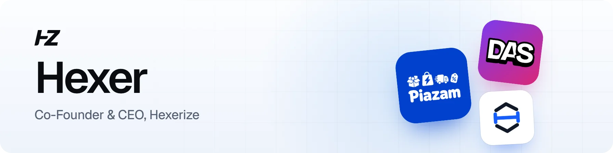
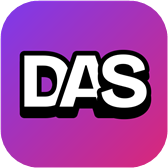

<picture>
  <source media="(prefers-color-scheme: dark)" srcset="assets/banner-dark.webp">
  
</picture>
  

I'm the co-founder and CEO of [Hexerize](https://hexerize.com), a technology company from Ghana building useful apps for everyone. I lead product and engineering across our apps, from the first idea to keeping them running every day.

## What we're building

<table>
  <tr>
    <td width="80" align="center"></td>
    <td><a href="https://piazam.com"><b>Piazam</b></a> Ghana's pre-order store for fashion, electronics and home goods, ordered factory-direct from China.</td>
  </tr>
  <tr>
    <td width="80" align="center"></td>
    <td><a href="https://dropasecret.com"><b>DropAsecret</b></a> Anonymous messages through your own link. Reply back and forth, and reveal names only when both people agree.</td>
  </tr>
  <tr>
    <td width="80" align="center"></td>
    <td><a href="https://hexerize.com/apps/hexersms/"><b>HexerSMS</b></a> School management for nursery, primary and JHS schools in Ghana. In development.</td>
  </tr>
</table>

## Recent writing

- [Piazam Points: a point for every cedi you spend](https://hexerize.com/blog/piazam-points/)
- [Why our website showed a 404 inside a video game](https://hexerize.com/blog/a-404-inside-a-game/)
- [Piazam's home page now uses less than half the data](https://hexerize.com/blog/piazam-lighter-home-page/)
- [The trailing slash that hid our blog from Google for four months](https://hexerize.com/blog/the-bug-that-hid-our-blog-from-google/)

More on the [Hexerize blog](https://hexerize.com/blog/).

## Get in touch

- Email: [hexer@hexerize.com](mailto:hexer@hexerize.com)
- LinkedIn: [linkedin.com/in/iamhexer](https://www.linkedin.com/in/iamhexer/)
- More about me: [hexerize.com/about/hexer](https://hexerize.com/about/hexer/)
